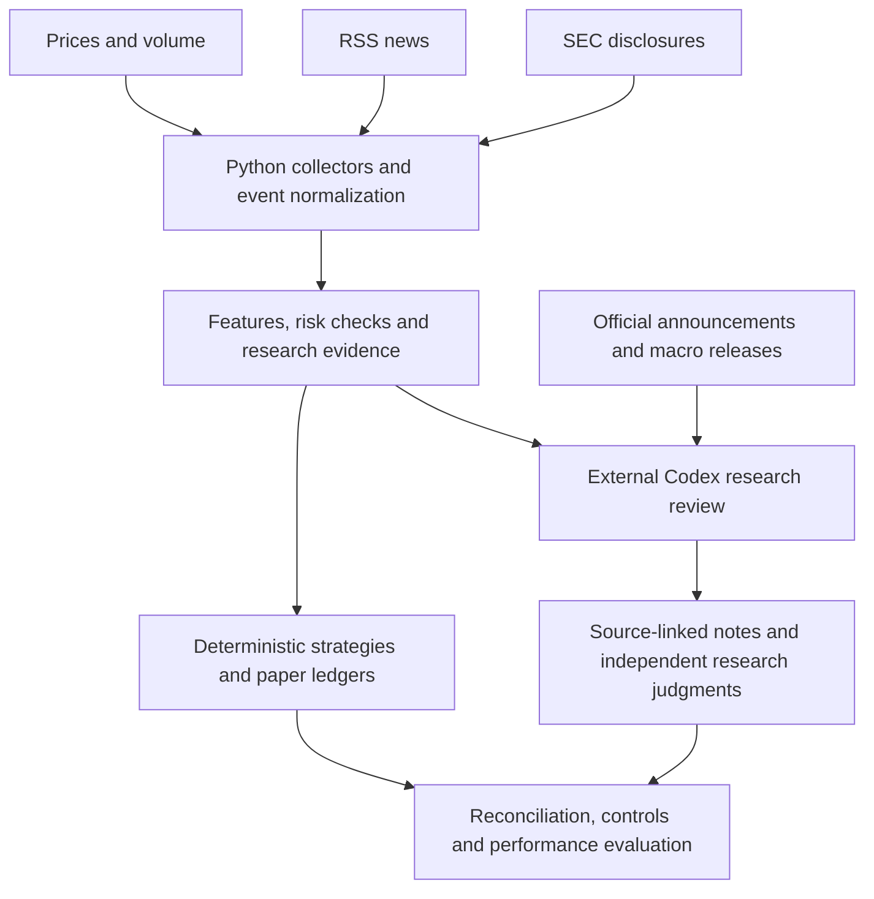

# Stock Master

**Market research, event monitoring, and paper-trading infrastructure, with a companion LLM-assisted research workflow.**

Stock Master collects market data, financial news, and public disclosures, organizes research evidence, and evaluates trading hypotheses against explicit controls. Python handles repeatable calculations and paper execution; an external Codex workflow supports evidence review and research judgment.

> **Research and educational use only. This project is not investment advice, a production trading service, or evidence of profitable AI trading. Paper results and backtests do not establish future performance.**

## What the project does

- Collects price and volume data through Yahoo Finance, aggregates ticker-related RSS news, and reads SEC disclosures through dedicated modules.
- Filters ticker relevance, deduplicates headlines, records event context, and produces technical, macro, options, and risk summaries.
- Maintains separate paper ledgers, event-study samples, strategy benchmarks, and shadow records rather than pooling unrelated results.
- Evaluates hypotheses using transaction-cost assumptions, random-entry controls, sensitivity checks, and prospective samples.
- Runs scheduled monitoring and supports Telegram commands and notifications; optionally connects to Alpaca paper accounts.
- Supports an external LLM-assisted workflow for checking source documents, explaining conflicting evidence, and producing traceable research notes.

## How LLMs and agents are used

The workflow has two distinct layers:

**Deterministic Python core, included in this repository.** Collectors, feature calculations, keyword-based news checks, risk rules, scheduling, and paper-account utilities run as normal Python code. `src/scheduler.py` does not call an LLM API. `src/debate.py` implements rule-based bull, bear, risk, and arbitrator roles; these are not separate LLM agents. The current code does not train or fine-tune an ML prediction model.

**Companion Codex research workflow, maintained outside this repository snapshot.** An external assistant uses public sources and timestamped collector outputs to review company filings, macro events, sector conditions, and portfolio risks. It distinguishes confirmed facts from interpretations, retains dates and source links, and can record prospective research judgments separately from the original strategy. Companion tooling includes read-only account reconciliation, market snapshots, and append-only research annotations. These tools and private evidence files are not supplied by cloning this repository.

The LLM assists research and decision review. It is not wired directly into the scheduler as an autonomous order planner, and a narrative recommendation does not automatically alter existing trading rules or submit an order. A separate experimental agent-to-paper-broker adaptation is still preparation work and is not presented as a completed execution integration.



## Repository map

- [`src/fetcher.py`](src/fetcher.py): price retrieval and daily-bar gap handling.
- [`src/news_aggregator.py`](src/news_aggregator.py): RSS aggregation, relevance filtering, headline deduplication, and keyword scoring.
- [`src/insider_tracker.py`](src/insider_tracker.py) and [`src/sec_13dg_monitor.py`](src/sec_13dg_monitor.py): public filing workflows.
- [`src/risk_layer.py`](src/risk_layer.py): strategy-independent risk checks.
- [`src/scheduler.py`](src/scheduler.py) and [`src/telegram_bot.py`](src/telegram_bot.py): recurring workflows and operator interaction.
- [`src/momentum_book.py`](src/momentum_book.py), [`src/options_auto.py`](src/options_auto.py), and [`src/alpaca_client.py`](src/alpaca_client.py): strategy ledgers and optional paper-account utilities.
- [`src/event_lab.py`](src/event_lab.py), [`src/options_shadow.py`](src/options_shadow.py), and [`src/overnight_lab.py`](src/overnight_lab.py): event and forward-observation experiments.
- [`src/backtest_research.py`](src/backtest_research.py): ablation studies and matched random-entry controls.
- [`tests/`](tests/): regression checks for data handling, risk logic, strategies, and account behavior.

Some retained modules represent earlier experiments. The legacy nine-gate scan is not the current automatic entry signal (`NINE_GATE_AS_SIGNAL = False`); keeping its code does not imply it has demonstrated predictive value. The former Flask web layer is no longer part of the application.

## Local setup

Use Python 3.11 or a compatible interpreter in an isolated environment:

```bash
git clone https://github.com/ZhenWei-Shi/stock-master.git
cd stock-master
python -m venv .venv
# Linux/macOS: source .venv/bin/activate
# Windows PowerShell: .\.venv\Scripts\Activate.ps1
python -m pip install -r requirements.txt
python -m pip install pytest
python -m pytest
python -m src.scheduler --help
```

Optional backtest dependencies are listed in `requirements-research.txt`. Some research tests are skipped when optional packages are absent. Test success checks software behavior; it does not validate an investment edge.

Starting the scheduler is an operational action: it can write ledgers and, when configured with broker credentials, invoke paper-account functionality. Inspect the selected strategy, account identity, paper endpoint, and configuration before enabling scheduled execution. This README intentionally does not include a command that starts continuous trading.

## Configuration and deployment

- Telegram uses `TELEGRAM_BOT_TOKEN` and `TELEGRAM_CHAT_ID`.
- Optional Alpaca integration uses `ALPACA_API_KEY` and `ALPACA_SECRET_KEY`.
- Supply credentials through the runtime environment. The application does not automatically load a local `.env` file.
- Keep credentials, account snapshots, private ledgers, and logs out of Git. The existing `.gitignore` excludes environment files and runtime data.
- The project has been operated on a small Ubuntu cloud VM. Memory-heavy reporting and research imports are isolated or loaded on demand; this is relevant on a roughly 1 GB host.
- The private deployment launcher and credentials are deliberately not included. No production-ready authentication, uptime guarantee, or universal restart procedure is claimed.

## Evaluation and limitations

Evidence is evaluated by its collection time, source, data completeness, and applicable ledger. Research comparisons include trading costs and matched controls where implemented. An unfilled order is not a completed trade; a stale or missing price is not a zero; forecasts and media reports are not confirmed events.

Free data may be delayed, missing, revised, or inconsistent. Backtests can contain selection, survivorship, execution, and look-ahead limitations. LLMs may hallucinate, misunderstand filings, or be influenced by retrieved content. Source links and timestamps improve reviewability but do not prove correctness or externally certify a record's time. No validated LLM trading advantage, model-accuracy percentage, or guaranteed return is claimed.

## Disclaimer

This is a personal research and software portfolio project. Its code, outputs, examples, and AI-generated analysis are provided for educational and experimental use, not as personalized investment recommendations or an offer to transact. Nothing here guarantees profitability, capital preservation, or suitability for a particular person.

Paper trading and hypothetical backtests do not reproduce all live-market conditions, liquidity, slippage, borrowing costs, or operational failures. Real trading can lose capital; options and leveraged products can create substantial losses. Independently verify data and analysis, protect credentials, and comply with applicable broker and data-provider terms before any use. The software is provided without a promise of accuracy, availability, or fitness for live trading; this statement does not attempt to waive rights that applicable law does not permit to be waived.

No `LICENSE` file is currently included. Do not assume this repository is distributed under MIT, Apache, or another open-source license.

**中文免责声明：** 本项目仅用于个人研究、学习和作品集展示，不构成投资建议或收益承诺。模拟、回测及大模型输出不代表真实交易结果，数据和分析可能存在错误；当前代码没有已验证的LLM交易优势。实际使用前应独立核实信息及风险，不应直接将AI输出视为下单指令。

---

Architecture and scope documented on 2026-10-15 from the local source snapshot. No account balance, secret, host address, or unverified performance figure is published here.
